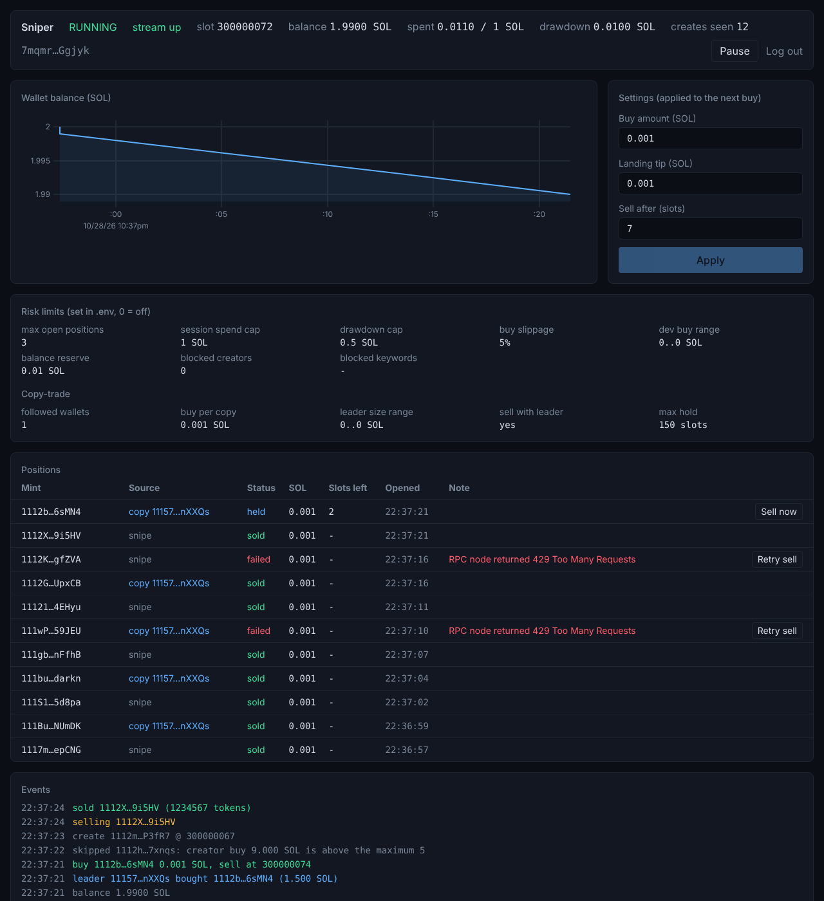
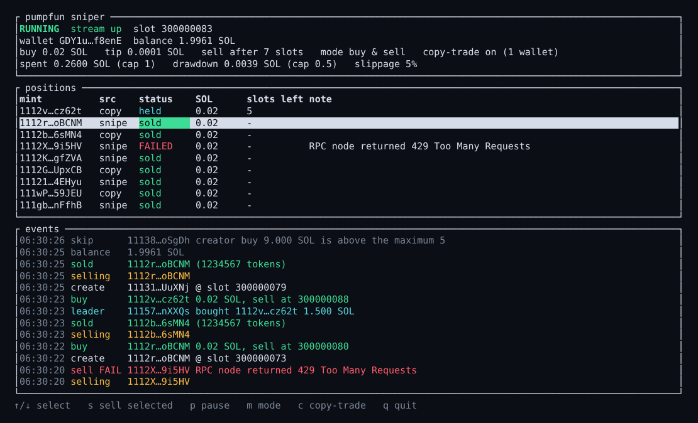
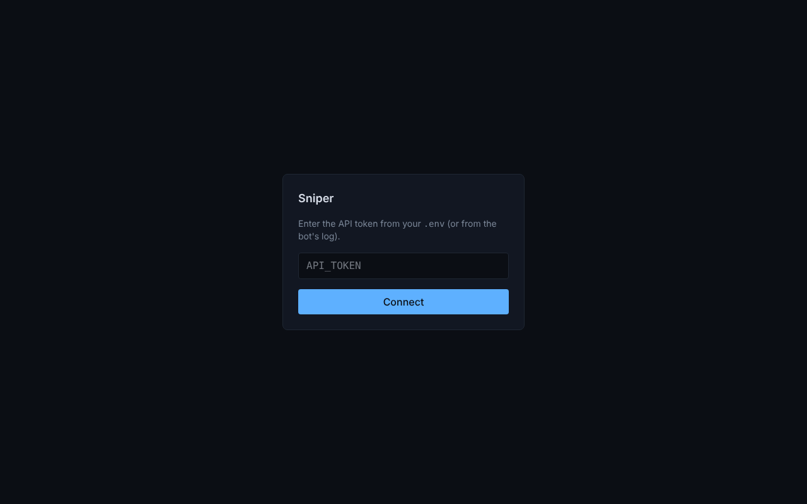

# Pump.fun Sniper Bot — Solana Memecoin Sniper (Rust + Jito Shredstream)

**Live Pump.fun sniper** for Solana. Detects new token creates from **Jito Shredstream**, buys in the same slot window, and exits on a delayed sell. Built in **Rust** with **Pump.fun** and **PumpSwap** SDKs — not a Node toy, not a log-subscribe bot.

[](https://solana.com)
[](https://www.rust-lang.org)
[](LICENSE)
[](https://pump.fun)
[](https://www.jito.wtf)
[](https://t.me/bondsbtc)

---

## Screenshots

Captured from `cargo run --example demo`, which runs the real dashboard and terminal UI on **simulated** activity (no wallet, RPC or Shredstream needed). Wallet addresses and token mints are random test values.

**Web dashboard** — status, wallet balance chart, live settings, risk and copy-trade limits, positions (snipes and copies) with *Sell now* / *Retry sell*, and the event feed (including tokens skipped by the risk checks).



**Terminal UI** (`--tui`) — the same live state in the terminal.



**Login** — the API only answers to the token from your `.env`.



## Why this sniper

Most public “Pump.fun snipers” wait on RPC logs or Helius webhooks. That is already late.

This bot ingests **Jito Shredstream entries** over gRPC, deserializes shreds, and matches Pump.fun `create` instruction discriminators before the market is crowded. Buys go out with compute-budget + tip accounts (Astralane / Jito-style bribes). A sell is cached and fired a few slots later.


## Features

- **Pump.fun create sniper** — parse mint, creator, amounts, and blockhash from the create tx
- **Jito Shredstream** — `ShredstreamProxy` subscribe, not Yellowstone-only logs
- **New coins with an active community** — only buys tokens created live, and only after enough different wallets bought them
- **Copy-trade** — mirror the Pump.fun buys of wallets you follow, sell when they sell
- **Risk limits** — position / spend / drawdown caps, slippage, creator and keyword filters
- **Dashboard** — web panel and terminal UI with live settings
- **Pump.fun SDK** — buy / sell instruction builder + versioned transactions
- **PumpSwap SDK** — AMM pool math, slippage, buy/sell execution
- **Pinned stack** — Rust 1.89.0, Solana SDK 3.x, thin LTO release builds

## Stack

| Layer | Tech |
| --- | --- |
| Language | Rust 1.89.0 (`rustfmt` + `clippy`) |
| Chain | Solana 3.x |
| Ingest | Jito Shredstream gRPC |
| Venues | Pump.fun · PumpSwap (SDK, not used by the sniper loop) |
| Landing | Astralane endpoint + tip |
| Runtime | Tokio, moka cache, rustls |

## How it works

```text
Shredstream proxy  →  deserialize entries  →  scan Pump.fun program
        ↓
   create discriminator match
        ↓
   parse mint / creator / buy amounts / blockhash
        ↓
   PumpFunSDK.buy  (+ compute budget, ATA, tip)
        ↓
   cache FutureSell  →  sell N slots later
```

1. Connect to `SHREDSTREAM_URL` (Cherry, Teraswitch, or Latitude).
2. Decode `solana_entry::Entry` batches from each slot.
3. If an instruction hits the Pump.fun program and the create discriminator, parse the tx.
4. Submit a buy with `SOL_BUY_AMOUNT` and `BRIBE_FEE`.
5. Queue an automatic sell after a short slot delay.

## Requirements

- Rust **1.89.0** (see `rust-toolchain.toml`)
- A funded Solana wallet
- Shredstream endpoint (not public RPC)
- An Astralane endpoint (or compatible) to send transactions through

## Configuration

Copy `.example.env` → `.env` (gitignored — never commit keys). Nothing secret or provider-specific is hardcoded; the bot refuses to start if a required variable is missing or invalid.

```env
PVT_KEY=BASE58_PVT_KEY_HERE
RPC_URL=https://YOUR_RPC_HOST/?api-key=YOUR_KEY
ASTRALANE_URL=http://YOUR_ASTRALANE_HOST/iris?api-key=YOUR_KEY
SHREDSTREAM_URL=http://YOUR_SHREDSTREAM_HOST:9999
SOL_BUY_AMOUNT=0.0001
BRIBE_FEE=0.0001
SELL_DELAY_SLOTS=7
```

| Variable | Required | Description |
| --- | --- | --- |
| `PVT_KEY` | yes | Wallet secret in base58 |
| `RPC_URL` | yes | RPC used for balances and blockhashes |
| `ASTRALANE_URL` | yes | Endpoint transactions are sent through |
| `SHREDSTREAM_URL` | yes | Jito shredstream proxy |
| `SOL_BUY_AMOUNT` | no (0.0001) | SOL size per Pump.fun buy |
| `BRIBE_FEE` | no (0.0001) | Landing tip in SOL |
| `SELL_DELAY_SLOTS` | no (7) | Slots to wait before selling |

### Risk limits

Every new token is checked before a buy; a refused one shows up as `skipped` in the dashboard with the reason. Set `0` to turn a limit off.

| Variable | Default | Meaning |
| --- | --- | --- |
| `MAX_OPEN_POSITIONS` | 3 | Positions held or being sold at once |
| `MAX_SESSION_SPEND_SOL` | 1.0 | Total SOL spent on buys per run |
| `MAX_SESSION_DRAWDOWN_SOL` | 0.5 | Stop buying when the wallet is this far below its starting balance (open positions count as spent until sold) |
| `MIN_BALANCE_RESERVE_SOL` | 0.01 | SOL that must remain after a buy |
| `BUY_SLIPPAGE_PERCENT` | 5 | Extra SOL (in %) the buy may cost if the price moves before it lands; max 50 |
| `MIN_DEV_BUY_SOL` / `MAX_DEV_BUY_SOL` | off | Only tokens whose creator buys within this range at launch |
| `BLOCKED_CREATORS` | none | Comma-separated creator addresses to ignore |
| `BLOCKED_KEYWORDS` | none | Comma-separated words; a token whose name or symbol contains one is ignored |

Sells still go out at any price (`min_sol_output = 0`): in a dumping market getting out matters more than the price, so there is no sell slippage limit. There is no stop-loss or take-profit; positions are sold after `SELL_DELAY_SLOTS`.

### Buy rule: new coins with an active community

The bot only buys **new coins**: tokens whose creation it saw live on the Shredstream (nothing that already existed when it started). With `REQUIRE_COMMUNITY=true` (the default) it then waits and buys only if the token shows an **active community**:

1. A token is created. The bot starts watching it instead of buying at once.
2. For `COMMUNITY_WINDOW_SLOTS` slots (default 10, about 4 seconds) it counts the buys of that token made by *different* wallets (the creator's own wallet does not count) and the SOL they bid.
3. At the end of the window it buys if there were at least `COMMUNITY_MIN_BUYERS` unique buyers (default 5) and at least `COMMUNITY_MIN_VOLUME_SOL` bid (default 0.5). Otherwise it records a `skipped` event with the numbers, e.g. `community: 2 of 5 unique buyers within 10 slots`.
4. The usual [risk limits](#risk-limits), pause and one-position-per-token rules still apply, and the buy is sized from the most recent buy it saw, not the stale launch price.

| Variable | Default | Meaning |
| --- | --- | --- |
| `REQUIRE_COMMUNITY` | `true` | `false` buys new coins as soon as they are created, with no community check |
| `COMMUNITY_WINDOW_SLOTS` | 10 | How long to watch a new token (1-100 slots, ~0.4 s each) |
| `COMMUNITY_MIN_BUYERS` | 5 | Different wallets that must have bought in that window |
| `COMMUNITY_MIN_VOLUME_SOL` | 0.5 | SOL that must have been bid in that window (0 = off) |
| `MAX_TOKEN_AGE_SLOTS` | 150 | [Copy-trade](#copy-trade) only follows buys of tokens at most this old (0 = no limit) |

Copy-trade follows the same rule: it only copies a leader's buy of a **new** token (seen created, not older than `MAX_TOKEN_AGE_SLOTS`) that already meets the community thresholds. The leader's buy itself counts as one of the buyers.

What this does and does not tell you:
- Waiting means you buy **later and at a higher price** than a same-slot snipe, and some tokens that would have run are missed. That is the price of not buying dead launches. Tune the window and thresholds, or set `REQUIRE_COMMUNITY=false`.
- The SOL amounts are what buyers were *willing* to pay (the cap in their instruction), not what they paid.
- It is on-chain activity only: one person with many wallets can fake unique buyers, and it does not look at Twitter, Telegram or the token page. It filters out launches nobody is buying; it does not prove the community is real.

### Copy-trade

Set `COPY_WALLETS` (comma-separated addresses) and the bot also watches those wallets on the same Shredstream feed. When one of them **buys** on the Pump.fun bonding curve, the bot buys the same token with a fixed amount; when it **sells** a token you copied, the bot sells yours. Leave `COPY_WALLETS` empty to turn it off.

| Variable | Default | Meaning |
| --- | --- | --- |
| `COPY_WALLETS` | none (off) | Wallets to follow |
| `COPY_BUY_SOL` | `SOL_BUY_AMOUNT` | SOL spent per copied buy, whatever the leader spent |
| `COPY_MIN_LEADER_SOL` / `COPY_MAX_LEADER_SOL` | off | Ignore leader buys smaller / larger than this |
| `COPY_SELL_WITH_LEADER` | `true` | Sell when the leader sells the same token |
| `COPY_MAX_HOLD_SLOTS` | 150 | Safety exit: sell after this many slots even if the leader never sells |

Copied buys go through the same checks as snipes: the [new-coin and community rule](#buy-rule-new-coins-with-an-active-community), the [risk limits](#risk-limits), pause, and one position per token (a token you already hold, or are buying, is never bought twice). Refusals show up as `skipped` with the reason, every leader trade shows up as a `leader` event, and positions are tagged `snipe` or `copy` in the dashboard and the terminal UI.

Things to know:
- Only **Pump.fun bonding-curve** trades of **new** tokens are copied (see the buy rule above), not PumpSwap, and only transactions whose accounts are listed directly (not through address lookup tables).
- The leader's "size" is the SOL cap in their instruction, which includes their own slippage allowance, not necessarily what they paid.
- Your buy lands *after* the leader's, so you pay a higher price. The price used for sizing is the leader's own maximum price; keep `BUY_SLIPPAGE_PERCENT` high enough for your buy to still land.
- The bot refuses to start if `COPY_WALLETS` contains its own wallet.
- Leaders can be wrong, or bait followers. Start with a small `COPY_BUY_SOL` and tight risk limits.

The sell reads the real token balance on-chain and uses a fresh blockhash, retrying a few times. If the buy never landed there is nothing to sell and the position is dropped with a log line. If the Shredstream connection drops, the bot reconnects with backoff and keeps its pending sells.

## Build and run

```bash
cargo build --release
cargo run --release
```

Use `--release`. Debug builds are too slow for slot-race sniping.

## Dashboard (web and terminal)

Two front ends share one live state, so they always agree: a **web panel** and a **terminal UI**. The trading loop only publishes events; it never waits for either, so a slow browser cannot delay a buy.

**Web panel**

```bash
cd ui && npm install && npm run build   # once, and after changing the UI
cargo run --release                     # then open http://127.0.0.1:8787
```

Log in with `API_TOKEN` (or the token printed in the log if you left it unset). It shows slot, stream status and wallet balance, a balance chart, positions with *Sell now* / *Retry sell*, and a live event feed. You can pause the bot and change buy amount, tip and sell delay without restarting; changes apply from the next buy and are bounded (buy at most 10 SOL, tip at most 0.1 SOL).

The API listens on `127.0.0.1` only and every call needs the token. Your wallet key never goes through it. To reach it from another machine use an SSH tunnel (`ssh -L 8787:127.0.0.1:8787 host`) instead of binding to a public address.

Customising the look: colours and fonts are tokens at the top of `ui/src/app.css`; layout is in `ui/src/App.svelte`. `npm run dev` serves it with hot reload and proxies to the running bot.

**Terminal UI**

```bash
cargo run --release -- --tui
```

Keys: `↑/↓` select, `s` sell the selected position, `p` pause/resume, `q` quit. Logs go to `sniper.log` while the TUI is open. Build without it using `--no-default-features`.

**Try it without a wallet:** `cargo run --example demo` (add `-- --tui`) runs both interfaces on simulated activity.

## Repository layout

```text
src/main.rs              Pump.fun create sniper entrypoint
src/risk.rs              Pre-buy risk checks and limits
src/state.rs             Shared live state, events and runtime settings
src/trader.rs            Sell execution with retries
src/api.rs               Dashboard API (REST + WebSocket) and static UI
src/tui.rs               Terminal dashboard (ratatui)
ui/                      Web dashboard (Svelte + Tailwind + uPlot)
src/types.rs             Shared buy/sell amounts and tx parsers
src/pumpfun/             Pump.fun constants, ix builder, SDK
src/pumpswap/            PumpSwap pool math, ix builder, SDK
jito_protos/             Jito shredstream protobuf definitions
```

## Contributions

This project started as [dexoryn](https://github.com/dexoryn)'s sniper; the credit for the original bot and its Pump.fun / PumpSwap SDKs is theirs. The changes below were added on top of it (PRs [#1](https://github.com/stalinesatola/pumpfun-sniper-bot/pull/1) and [#2](https://github.com/stalinesatola/pumpfun-sniper-bot/pull/2)):

- **Security** — removed every hardcoded API key and wallet secret from the code and rewrote the git history to drop them; all endpoints and keys now come from `.env`, validated at startup so a bad value fails with a clear message instead of a panic.
- **Robustness** — Shredstream reconnects with backoff and keeps pending sells; sells use the real on-chain token balance and a fresh blockhash, retry, and a position can never be sold twice; the transaction parser no longer panics on lookup-table or truncated data; the `unwrap()`s on the trading path became proper errors.
- **Dashboard** — a web panel (Svelte 5, Tailwind, uPlot) and a terminal UI (`ratatui`) sharing one live state, with pause, manual sell and runtime settings. The trading loop only publishes events and never waits for the UI. The API is localhost-only and token-protected.
- **Buy rule** — only new coins, and only once they show an active community (unique buyers and SOL bid within a short window); copy-trade follows the same rule.
- **Copy-trade** — follow wallets and mirror their Pump.fun buys and sells, with the same risk checks, one position per token, and a safety exit.
- **Risk limits** — position, spend and drawdown caps, balance reserve, creator and keyword filters, creator launch-buy range, and configurable buy slippage; every refusal is shown with its reason.
- **Fix** — the Pump.fun buy asked for the wrong number of tokens whenever the price was not close to the launch price (it multiplied by the price instead of dividing), so the buy could fail on-chain; it now sizes from the reference buy's own price.
- **Dependencies and tooling** — migrated to Solana SDK 3.x on Rust 1.89, with byte-for-byte golden tests of the transactions and the Shredstream entry format captured before the upgrade; known vulnerabilities in the dependency tree went from 41 to 3 (all `zstd`, upstream); unused dependencies removed; `dotenv` replaced by `dotenvy`.
- **Cleanup and CI** — about 6,300 lines of unused code removed (the old copy-trade listener, which did not compile, Yellowstone gRPC, Whirlpool, Jito searcher client); `cargo fmt`, GitHub Actions (format, build, test, clippy, UI build, informational `cargo audit`) and Dependabot.

**What is and is not verified:** the unit, API, terminal-UI and golden tests pass, and the dashboards were exercised in a real browser and terminal against the demo. The bot itself has **not** been run against live Shredstream, RPC or on-chain orders by these changes — try it with a tiny `SOL_BUY_AMOUNT` first.


## License

[MIT](LICENSE).

## Disclaimer

Trading memecoins can result in total loss of funds. You own your keys, RPC/Shredstream costs, tips, and legal compliance. This repo is provided as-is. No profit is guaranteed.

Keep `.env` local. Rotate any key that has ever been pasted into chat, screenshots, or git history.
